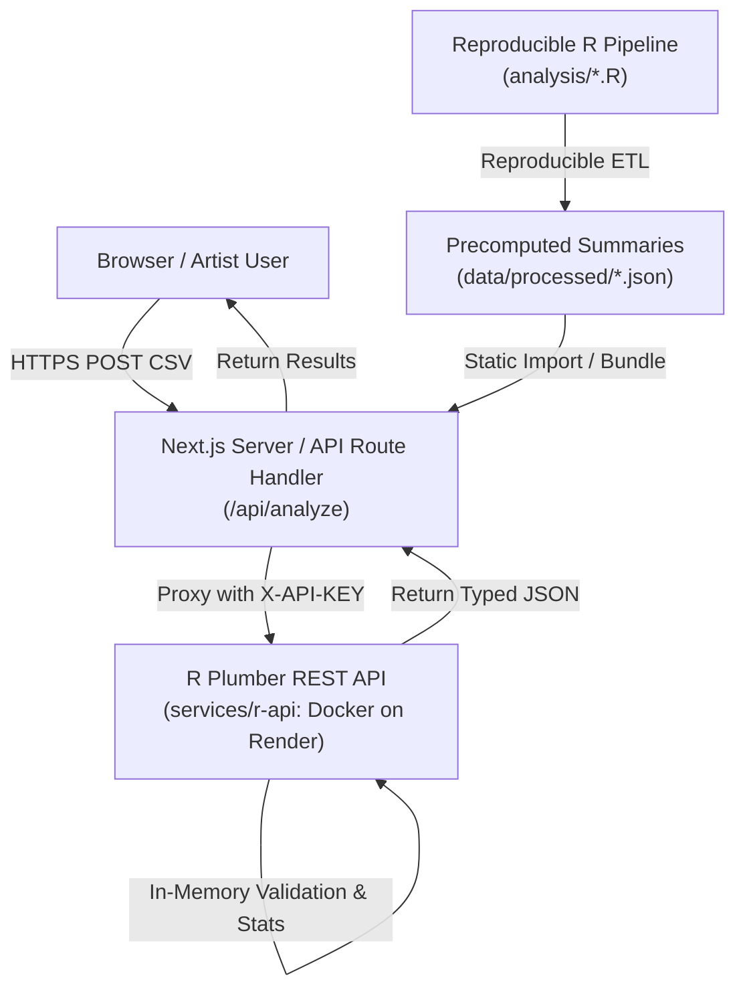

# System Architecture: Spotify Release Advisor

## 1. System Overview
The Spotify Listener Behaviour Analysis and Optimal Release-Window Advisor is organized as a production-quality Git monorepo separating analytical R services from user-facing Next.js components.



## 2. Directory Layout
```
Spotify IDS/
├── .github/workflows/
│   ├── r-ci.yml                 # R testthat & endpoint verification
│   └── web-ci.yml               # Next.js build & TypeScript validation
├── analysis/                    # Reproducible R research pipeline
│   ├── 01_audit_data.R          # Profiling and missingness audit
│   ├── 02_clean_data.R          # Data type cleaning & outlier handling
│   ├── 03_listening_analysis.R  # 168-hour activity matrix computation
│   ├── 04_release_performance.R # ANOVA, 95% CIs, and age-adjusted OLS
│   └── 05_advisor_scoring.R     # Multi-criteria candidate ranking
├── apps/web/                    # Next.js 14 App Router (Vercel)
│   ├── public/templates/        # Downloadable sample CSV templates
│   ├── src/app/                 # 6 dedicated pages + /api/analyze route
│   ├── src/components/          # Recharts, Heatmap, and Table components
│   └── src/types/               # Strongly-typed analytical schemas
├── data/
│   ├── raw/                     # Source datasets (ignored in git)
│   └── processed/               # Reproducible JSON summaries
├── docs/                        # Architecture, Methodology, and Guides
├── reports/                     # Academic case study report & presentation
├── services/r-api/              # R Plumber Microservice (Render)
│   ├── Dockerfile               # Production container definition
│   ├── api.R                    # Plumber endpoints
│   ├── R/                       # Modular R validators, stats, and scoring
│   └── tests/                   # 50 testthat assertions & integration tests
├── render.yaml                  # Render Blueprint definition
├── vercel.json                  # Vercel configuration
└── README.md                    # Quickstart guide
```

## 3. Communication & Security Architecture
1. **Next.js Server Proxy:** Browser clients never communicate directly with the backend R service or see internal API keys. All traffic passes through the server route `/api/analyze`.
2. **Authentication:** The Next.js server signs requests with an `X-API-KEY` shared secret matched against `API_SECRET_KEY` on Render.
3. **Zero-Storage Privacy:** User CSV rows are processed strictly in-memory in R and never stored in files or databases.
4. **Resilient Local Execution:** If the R Plumber HTTP daemon is offline locally, the Next.js route handler seamlessly executes the analytical modules directly via `Rscript`, guaranteeing R computations.
