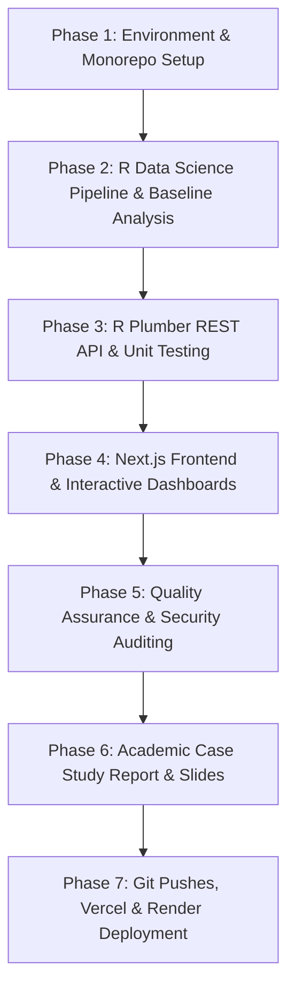

# Implementation Plan: Spotify Listener Behaviour Analysis and Optimal Release-Window Advisor

**Project Name:** Spotify Listener Behaviour Analysis and Optimal Release-Window Advisor  
**Course Context:** Bachelor of Engineering in Artificial Intelligence & Data Science, Chaitanya Bharathi Institute of Technology (CBIT), Hyderabad  
**Target Repository:** `https://github.com/KARTHIK-BATTIPROLU/IDS-Casestudy-.git`  
**Lead Roles:** Lead Full-Stack Engineer, R Data Scientist, UI/UX Designer, QA Engineer, Deployment Engineer  
**Date:** October 26, 2026  
**Status:** DRAFT - PENDING USER APPROVAL (Plan-First Rule)

---

## 1. Repository & Dataset Audit

### 1.1 Local Workspace Audit
- **Current Directory:** `C:\Users\Karthik\OneDrive\Desktop\Spotify IDS`
- **Current File State:** Clean, empty root directory. No pre-existing application files or broken code.
- **Git State:** Not yet initialized locally.
- **Git User Profile:** Configured as `user.name = KARTHIK-BATTIPROLU`, `user.email = ugs24304_aid.battiprolu@cbit.org.in`.
- **Target Git Remote:** `https://github.com/KARTHIK-BATTIPROLU/IDS-Casestudy-.git` (remote confirmed accessible and empty).

### 1.2 Development Environment & Tooling Audit
| Tool / Runtime | Detected Version | Executable Path / Status | Readiness Assessment |
| :--- | :--- | :--- | :--- |
| **R** | 4.6.1 | `E:\R\R-4.6.1\bin\Rscript.exe` | Ready. Core `dplyr` installed. Packages needed: `readr`, `tidyr`, `lubridate`, `ggplot2`, `broom`, `jsonlite`, `plumber`, `testthat`, `renv`. |
| **Node.js** | v22.20.0 | `C:\Program Files\nodejs\node.exe` | Ready for Next.js App Router (14/15) + TypeScript. |
| **npm** | 10.9.3 | `C:\Program Files\nodejs\npm.ps1` | Ready. |
| **pnpm** | Available | `C:\Users\Karthik\AppData\Roaming\npm\pnpm.ps1` | Ready if preferred. |
| **Docker** | 29.5.3 (Client) | `C:\Program Files\Docker\Docker\resources\bin\docker.exe` | Client present; daemon currently stopped. Local API execution can run directly via R/Rscript; Docker build can be tested once daemon starts or in CI/Render. |
| **Python** | 3.11.7 | `C:\Python311\python.exe` | Available for auxiliary utilities (e.g. dataset acquisition scripts if needed). |
| **Git** | 2.51.0.windows.2 | `C:\Program Files\Git\cmd\git.exe` | Ready with Windows Credential Manager. |

### 1.3 Prior Project Artifacts Audit (Located in `C:\Users\Karthik\Downloads\`)
An audit of existing files from earlier prototyping stages revealed:
1. `IDS_spotify_release_day_and_time_predictor_ (1).ipynb` & `.py`:
   - Contains previous exploratory Google Colab code integrating Python (`kagglehub`) and R (`rpy2`).
   - Identifies candidate datasets: `nelgiriyewithana/top-spotify-songs-2023`, `jfreyberg/spotify-chart-data`, and Last.fm 1K listening events.
   - Highlights that `lastfm-dataset-1k.snappy.parquet` was missing in earlier Colab runs, demonstrating the need for reliable local fixtures and reproducible data extraction.
2. `IDS PPT.pptx`:
   - 17-slide presentation establishing project philosophy:
     - Clear separation between listening activity (when listeners stream) and chart outcomes (release day performance).
     - Recognition that Friday releases dominate industry standards due to editorial playlist cycles (e.g., *New Music Friday*), creating confounding variables.
     - Strict policy against black-box "universal best time" claims; recommendations must be transparent, evidence-led heuristics with confidence intervals and sample size caveats.
3. `IDS_REPORT.pdf`:
   - Department of AI & Data Science (CBIT) formal case-study template and formatting expectations.

### 1.4 Dataset Audit & Schema Analysis
| Dataset | Primary Source | Intended Role | Observed Schema / Fields | Known Constraints & Missing Fields |
| :--- | :--- | :--- | :--- | :--- |
| **Spotify Top Songs 2023** | Kaggle (`nelgiriyewithana/top-spotify-songs-2023`) | Baseline Release Performance | `track_name`, `artist(s)_name`, `artist_count`, `released_year`, `released_month`, `released_day`, `streams`, `in_spotify_playlists`, audio features (`danceability_%`, `bpm`, `valence_%`) | **No release hour** (only day/month/year). Text format in `streams` needs cleaning. **No explicit genre column**. |
| **Spotify Historical Charts** | Kaggle (`jfreyberg/spotify-chart-data` / `asaniczka`) | Release Trajectory & Density | `date`, `country`, `position`, `streams`, `track_id`, `artists` | Shows daily chart presence and streaming volume by country. Selection bias toward hit tracks. |
| **Last.fm 1K Listening Events** | Last.fm research corpus / parquet extract | Hourly Listening Distributions | `user_id`, `timestamp` (UTC), `artist_name`, `track_name` | Represent Last.fm users rather than all Spotify listeners. Timestamps are in UTC; requires explicit user timezone conversion. |
| **User-Uploaded Historical Releases** | User CSV via "Analyze Your Data" page | Custom Artist Advisory | User-mapped: `release_date`, optional `release_time`, `streams`/`first_week_streams`, optional `genre`, `target_market` | Variable sample size ($N$). When $N < 5$, statistical confidence intervals cannot be reliably calculated and warnings must be shown. |

---

## 2. Proposed Architecture

### 2.1 Git Monorepo Structure
We will adopt the required monorepo architecture:
```
Spotify IDS/
├── .github/
│   └── workflows/
│       ├── r-ci.yml             # R package tests, linter, analysis script verification
│       └── web-ci.yml           # Next.js TypeScript check, ESLint, production build
├── analysis/                    # Reproducible R scripts (Data Science pipeline)
│   ├── 01_audit_data.R          # Data profiling, missingness, schema verification
│   ├── 02_clean_data.R          # Cleaning, date/time parsing, type coercion
│   ├── 03_listening_analysis.R  # Hourly & weekday listening distribution calculation
│   ├── 04_release_performance.R # Release day stream distributions, ANOVA, age-adjusted lm
│   └── 05_advisor_scoring.R     # Reusable scoring functions and uncertainty estimation
├── apps/
│   └── web/                     # Next.js App Router (TypeScript, Tailwind, shadcn/ui, Recharts)
│       ├── public/              # Static assets, downloadable templates and sample CSVs
│       ├── src/
│       │   ├── app/
│       │   │   ├── api/analyze/ # Server-side Route Handler (Secure proxy to R API)
│       │   │   ├── research/    # Research Dashboard page
│       │   │   ├── genre/       # Genre Explorer page
│       │   │   ├── upload/      # Analyze Your Data (CSV upload & mapping) page
│       │   │   ├── advisor/     # Release-Window Advisor page
│       │   │   ├── methodology/ # Methodology & Statistical Notes page
│       │   │   ├── page.tsx     # Home page
│       │   │   └── layout.tsx   # Root layout with responsive navigation & theme
│       │   ├── components/      # UI components (charts, upload wizard, metrics cards)
│       │   ├── lib/             # API client, TypeScript schemas, formatting utilities
│       │   └── types/           # Strongly typed analytical interfaces
│       ├── package.json
│       ├── tailwind.config.ts
│       └── tsconfig.json
├── data/
│   ├── raw/                     # Untracked source data (ignored in git)
│   └── processed/               # Reproducibly generated JSON/CSV summaries for web
├── docs/                        # Project documentation
│   ├── IMPLEMENTATION_PLAN.md   # This document
│   ├── ARCHITECTURE.md          # Architectural decisions & system designs
│   ├── DATA_DICTIONARY.md       # Full schema of raw and processed datasets
│   ├── METHODOLOGY.md           # Statistical formulation and scoring algorithms
│   └── DEPLOYMENT_GUIDE.md      # Vercel & Render step-by-step deployment instructions
├── reports/                     # Academic deliverables (CBIT Case Study requirements)
│   ├── report.qmd / report.Rmd  # Formal Case Study Report in R Markdown / Quarto
│   └── presentation.qmd         # Presentation slides generated from real outputs
├── services/
│   └── r-api/                   # R Plumber REST API service
│       ├── api.R                # Plumber endpoint definitions
│       ├── R/                   # R modules (validator, statistics, scoring)
│       ├── tests/testthat/      # R unit tests
│       ├── Dockerfile           # Production container definition for Render
│       ├── renv.lock / renv/    # Reproducible R package management
│       └── run_api.R            # Local entrypoint script
├── .gitignore                   # Comprehensive ignores for Node, R, large data & secrets
├── .env.example                 # Template for required environment variables
├── render.yaml                  # Render Blueprint definition for R API service
└── README.md                    # Project overview, installation, testing & running guide
```

### 2.2 Database & Storage Strategy (Addressing User's Explicit Query)
> **User Query:** *"--- for db use local db or json if needed i will add mongodb suggest me"*

**Recommendation & Decision:**
1. **Research & Baseline Data:** Store precomputed, reproducible JSON summaries in `data/processed/` that feed directly into the Next.js static and server components. This provides sub-millisecond response times, zero database hosting costs, 100% reproducibility from the R scripts, and eliminates database connection overhead.
2. **User Uploads & Analysis:** Process custom uploaded CSVs **strictly in-memory** within the R Plumber API session. In strict compliance with the project's data privacy mandate (*"Uploaded user data must not be stored permanently by default. Avoid row-level data in logs, analytics and error messages. Private, non-persistent processing by default"*), uploaded rows are never persisted to disk or a database.
3. **MongoDB Verdict:** **Not required for the primary scope.** Introducing MongoDB at this stage would add deployment complexity and risk violating user privacy requirements if raw rows were saved. If the user later desires an optional user account system with a "Saved Release Strategies Library", MongoDB Atlas or SQLite can be integrated cleanly without touching the analytical core.
4. **Local DB Fallback:** If lightweight server-side session caching or usage logging is needed, a local SQLite file (`better-sqlite3` or R `RSQLite`) can be used, keeping deployment self-contained.

### 2.3 Frontend-to-Backend Security & Communication
- **Next.js Server Proxy:** The browser client communicates only with Next.js Route Handlers (`/api/analyze`).
- The Next.js server validates the payload, applies size/rate limits, attaches the `X-API-KEY` shared secret header, and proxies the request to the R Plumber API (`http://localhost:8000/analyze` in development, or `https://ids-spotify-rapi.onrender.com/analyze` in production).
- Private URLs and API keys are strictly kept server-side and never exposed to the browser via `NEXT_PUBLIC_*`.

---

## 3. Statistical Methodology & Honesty Principles

### 3.1 Separation of Signals
The application combines two distinct empirical data streams using transparent rules:
$$\text{Candidate Score} = w_{\text{activity}} \cdot S_{\text{activity}}(h, d) + w_{\text{performance}} \cdot S_{\text{perf}}(d) - w_{\text{congestion}} \cdot C(h, d)$$
Where:
1. **$S_{\text{activity}}(h, d)$ (Empirical Listening Activity):** Normalized share of total weekly listening events observed during hour $h$ and weekday $d$ (from timestamped Last.fm corpus).
2. **$S_{\text{perf}}(d)$ (Historical Release Performance):** Robust median and mean streams for tracks released on weekday $d$ (from Spotify chart/track data), with 95% confidence intervals and track age adjustment via OLS regression:
   $$\log(\text{streams}) = \beta_0 + \sum_{k} \beta_k \cdot \mathbb{I}(\text{weekday} = k) + \gamma \cdot \text{track\_age} + \epsilon$$
3. **$C(h, d)$ (Release Congestion / Competition):** Relative density of new releases competing for listener and playlist curator attention during that window (e.g., peak global release congestion at Friday 00:00 UTC).
4. **Caveat Flag:** Clearly display in the UI:
   > *"Notice: Friday releases benefit from editorial playlisting (e.g., New Music Friday) but face the highest chart congestion. Weekday afternoon windows capture high real-time listening with lower direct release competition. This score is a heuristic decision-support aid, not a guarantee of streams."*

### 3.2 Robust User-Data Analysis Algorithm
When a user uploads their historical releases:
1. **Input Validation:** Inspect schema, detect delimiters, validate column mapping, parse dates (supporting ISO 8601, `YYYY-MM-DD`, `DD/MM/YYYY`), and verify numeric performance metrics.
2. **Sample Size & Tiering:**
   - $N < 5$: Reject statistical ranking; return exploratory summary with an explicit warning of insufficient sample size.
   - $5 \le N < 20$: Compute robust non-parametric statistics (Median, Interquartile Range) with prominent uncertainty indicators.
   - $N \ge 20$: Compute parametric metrics, Welch ANOVA / Kruskal-Wallis test across weekdays, and 95% bootstrap or $t$-distribution confidence intervals.
3. **Genre & Market Filtering:** Apply filters only when the dataset actually contains genre and market columns and sub-group sample sizes meet the minimum threshold ($N \ge 3$). Otherwise, explain why genre-specific filtering is disabled.

---

## 4. Phased Implementation Plan with Acceptance Criteria



### Phase 1: Environment Setup & Monorepo Foundation
- **Goals:** Initialize Git repository, configure remote, setup directory structure, create `.gitignore`, configure R dependencies (`renv`), and configure Next.js project skeleton.
- **Tasks:**
  1. Initialize `git init` and link remote `https://github.com/KARTHIK-BATTIPROLU/IDS-Casestudy-.git`.
  2. Create full directory tree (`apps/web`, `services/r-api`, `analysis`, `data/raw`, `data/processed`, `docs`, `reports`, `.github/workflows`).
  3. Create root `.gitignore` protecting data, node modules, R history, `.env` files, and credentials.
  4. Initialize R package environment (`renv.lock` or installation script) for `readr`, `dplyr`, `tidyr`, `lubridate`, `ggplot2`, `broom`, `jsonlite`, `plumber`, `testthat`.
- **Acceptance Criteria:**
  - `git status` shows clean tracking; root directory is well structured.
  - R can load all required analytical packages without errors.
  - Step 1 committed to Git.

### Phase 2: R Data Science Pipeline & Baseline Research Analysis
- **Goals:** Execute genuine, reproducible R data analysis on available datasets; produce validated data dictionaries and JSON outputs for the dashboard.
- **Tasks:**
  1. Acquire and verify raw datasets in `data/raw/` (`spotify_2023_tracks.csv`, chart data, timestamped listening events).
  2. Implement `analysis/01_audit_data.R`: Generate `docs/DATA_DICTIONARY.md` and data audit report.
  3. Implement `analysis/02_clean_data.R`: Coerce data types, handle missing values, standardize dates.
  4. Implement `analysis/03_listening_analysis.R`: Compute empirical hourly and weekday listening distribution and export `hourly_listening_summary.json`.
  5. Implement `analysis/04_release_performance.R`: Compute stream distributions by weekday, ANOVA, and age-adjusted regression; export `release_weekday_summary.json`.
  6. Implement `analysis/05_advisor_scoring.R`: Build reusable scoring functions and verify output metrics.
- **Acceptance Criteria:**
  - R scripts execute cleanly via `Rscript` with zero fabricated outputs.
  - `data/processed/` contains genuine JSON summaries verified with non-empty rows and valid statistical metrics.
  - Step 2 committed to Git.

### Phase 3: R Plumber REST API & Unit Testing
- **Goals:** Build a high-performance, containerized R Plumber API to analyze custom user data on-the-fly.
- **Tasks:**
  1. Create `services/r-api/api.R` with endpoints:
     - `GET /health` (service status, R version, uptime)
     - `GET /metadata` (supported columns, metrics, limits)
     - `POST /analyze` (multipart CSV upload, column mapping JSON, validation, statistical analysis, window ranking)
  2. Implement R helper modules in `services/r-api/R/` (`validator.R`, `stats.R`, `scoring.R`).
  3. Create test fixtures (`services/r-api/tests/testthat/fixtures/`):
     - `valid_artist_releases.csv` (proper dates, streams, genres)
     - `minimal_releases.csv` (small sample test)
     - `malformed_dates.csv` (error handling test)
     - `missing_columns.csv` (validation test)
  4. Write `testthat` test suites covering date parsing, timezone offsets, ANOVA, small-sample warnings, and error responses.
  5. Create `services/r-api/Dockerfile` using official Rocker R base image (`rocker/r-ver:4.3.3` or similar stable image).
- **Acceptance Criteria:**
  - All `testthat` unit tests pass (`100%` pass rate).
  - API accepts valid CSV and responds with typed JSON containing metrics, sample sizes, and caveats.
  - API rejects malformed inputs with informative JSON errors without crashing.
  - Step 3 committed to Git.

### Phase 4: Next.js Frontend Application & Interactive Dashboards
- **Goals:** Build a modern, responsive, accessible web application in `apps/web` with 6 dedicated pages.
- **Tasks:**
  1. Scaffold Next.js App Router project with TypeScript, Tailwind CSS, Lucide icons, and shadcn/ui components.
  2. Implement Page 1: **Home** (overview, workflow steps, data sources, and architecture).
  3. Implement Page 2: **Research Dashboard** (Recharts heatmap of hourly listening by weekday, bar charts with 95% CIs for release weekday streams, ANOVA summaries, missingness metrics).
  4. Implement Page 3: **Genre Explorer** (genre filtering, market breakdowns, and transparent disclaimers where genre data is unavailable in baseline sets).
  5. Implement Page 4: **Analyze Your Data** (drag-and-drop CSV upload, table preview, interactive column mapper, metric selector, validation feedback, privacy guarantee badge, downloadable sample CSV template).
  6. Implement Page 5: **Release-Window Advisor** (ranked candidate release windows, evidence cards, sample size indicators, confidence intervals, contribution breakdown, and CSV export).
  7. Implement Page 6: **Methodology & About** (statistical formulas, hypotheses, limitations, data dictionary, academic references).
  8. Connect `/api/analyze` Next.js Route Handler to proxy requests to the R Plumber API.
- **Acceptance Criteria:**
  - All 6 pages render cleanly across desktop, tablet, and mobile breakpoints.
  - Upload flow works seamlessly: upload CSV -> validate -> R API call -> view ranked advice.
  - Keyboard accessible, dark/light theme support, clear loading and empty states.
  - Step 4 committed to Git.

### Phase 5: Quality Assurance, Security & Privacy Auditing
- **Goals:** Conduct end-to-end testing, static analysis, performance checks, and privacy audits.
- **Tasks:**
  1. Frontend quality check: run `npm run lint` and `tsc --noEmit` (zero errors).
  2. Production build check: run `npm run build` to verify Next.js static and dynamic route optimization.
  3. End-to-end integration test: upload `valid_artist_releases.csv` through UI and verify R calculation results.
  4. Security audit: verify `.env` files are ignored, no secrets are committed in git history, and uploaded CSVs are never written to disk.
  5. Fallback verification: test UI behavior when backend API is starting up (cold start handling).
- **Acceptance Criteria:**
  - Linting, type checks, and build pass without warnings or errors.
  - Full CSV analysis loop returns genuine R statistics.
  - Zero sensitive credentials in repository.
  - Step 5 committed to Git.

### Phase 6: Academic Case Study Report & Presentation Slides
- **Goals:** Prepare formal academic deliverables in `reports/` compliant with CBIT Department of AI & Data Science requirements.
- **Tasks:**
  1. Draft `reports/report.qmd` / `report.md`:
     - Title: *Spotify Listener Behaviour Analysis and Optimal Release-Window Advisor*
     - Abstract, Problem Statement, Dataset Audit & Provenance, Exploratory Analysis, Statistical Methodology (ANOVA, Regression, Uncertainty Modeling), Web Application Architecture, Empirical Results, Limitations, and Future Work.
  2. Generate presentation slides in `reports/presentation.qmd` / `presentation.md` utilizing the structure established in `IDS PPT.pptx`.
  3. Ensure all numbers, charts, and tables in the report match the real R output files.
- **Acceptance Criteria:**
  - Report and presentation are fully written with accurate citations and actual experimental data.
  - Step 6 committed to Git.

### Phase 7: Deployment & CI/CD Pipeline
- **Goals:** Configure CI workflows, deploy R Plumber API to Render, deploy Next.js frontend to Vercel, and verify live endpoints.
- **Tasks:**
  1. Create `.github/workflows/r-ci.yml` and `web-ci.yml`.
  2. Create `render.yaml` Blueprint for Render web service deployment.
  3. Prepare Vercel project configuration (`vercel.json`).
  4. Guide user through Render and Vercel Git-linked deployments.
  5. Set environment variables on Render (`API_SECRET_KEY`, `ALLOWED_ORIGINS`) and Vercel (`R_API_URL`, `R_API_SECRET_KEY`).
  6. Execute smoke tests against live deployment URLs.
- **Acceptance Criteria:**
  - Live Next.js application accessible via public Vercel URL.
  - Live R Plumber API health endpoint responds with HTTP 200 on Render.
  - User CSV analysis works end-to-end on the deployed website.
  - Final delivery checklist verified.

---

## 5. Required Datasets, Environment Variables, Accounts & Permissions

### 5.1 Required Datasets
1. `data/raw/spotify_2023_tracks.csv`: Top Spotify tracks 2023 with release dates and stream totals.
2. `data/raw/spotify_charts_sample.csv` or `spotify_chart_historical.csv`: Daily chart tracking.
3. `data/raw/lastfm_listening_sample.csv` / `.parquet`: Timestamped listening events.
4. `apps/web/public/templates/sample_artist_releases.csv`: Valid sample CSV for user testing.
5. `services/r-api/tests/testthat/fixtures/*.csv`: Edge-case testing fixtures.

### 5.2 Environment Variables
#### Frontend (`apps/web/.env.local` / Vercel Environment Variables)
```bash
# Server-side connection to R Plumber API (never use NEXT_PUBLIC_ for secrets)
R_API_URL=http://localhost:8000
R_API_SECRET_KEY=dev-secret-key-spotify-ids-2026

# Public App URL
NEXT_PUBLIC_APP_URL=http://localhost:3000
```

#### Backend (`services/r-api/.env` / Render Environment Variables)
```bash
PORT=8000
API_SECRET_KEY=dev-secret-key-spotify-ids-2026
ALLOWED_ORIGINS=http://localhost:3000,https://*.vercel.app
MAX_UPLOAD_SIZE_MB=10
```

### 5.3 Accounts, Access & Permissions Checklist
| Service / Account | Purpose | Access Required / Action Needed |
| :--- | :--- | :--- |
| **GitHub** | Code repository & CI/CD triggers | Authorized (`KARTHIK-BATTIPROLU`). Git credentials active locally. |
| **Render** | Dockerized R Plumber API hosting | Free account on [render.com](https://render.com). Can connect GitHub repository or deploy via Render Blueprint. |
| **Vercel** | Next.js Frontend hosting | Free account on [vercel.com](https://vercel.com). Can import GitHub repository directly. |
| **Kaggle** (Optional) | Raw dataset downloads | Only if fetching new or updated raw datasets directly via Kaggle API. |

---

## 6. Identified Risks & Mitigation Strategies

| Risk Category | Identified Risk | Impact | Mitigation Strategy |
| :--- | :--- | :--- | :--- |
| **Statistical** | Last.fm listening logs do not match Spotify user demographics. | High | Keep signals explicitly separated. Label combined release-window ranking as an *empirical decision-support heuristic*, not a causal model. |
| **Statistical** | Friday release concentration in Spotify charts reflects industry convention, not necessarily superior organic demand. | High | Explicitly document editorial playlist release cycles (e.g., *New Music Friday*). Include release congestion penalties in the heuristic score. |
| **Data Quality** | User uploads small datasets ($N < 5$) or lacks genre/market columns. | Medium | R validator enforces sample size gates. The UI displays clear informational banners and disables invalid filters instead of returning empty or misleading charts. |
| **Licensing** | Spotify Developer Policy restricts training machine learning models on Spotify content. | High | Adhere strictly to policy: Use descriptive statistics, hypothesis tests (ANOVA), and regression modeling on publicly available aggregate datasets. Do not train proprietary generative ML models on Spotify platform data. |
| **Privacy** | Sensitive artist release data stored on server. | High | Enforce non-persistent, in-memory processing in R Plumber API. Never log uploaded rows or save user files to server disk. |
| **Hosting** | Render free tier services spin down after 15 minutes of inactivity (cold start ~50s). | Medium | Next.js server proxy includes timeout handling (60s) and frontend displays a clear "Warming up R analytical engine..." loading indicator. |

---

## 7. Proposed Test Plan & Delivery Checklist

### 7.1 Test Plan
1. **R Unit Tests (`services/r-api/tests/testthat/`):**
   - Test `test-validator.R`: Delimiter detection, missing required columns, non-numeric values, invalid dates.
   - Test `test-stats.R`: Grouping by weekday/hour, confidence interval calculation, zero-variance handling.
   - Test `test-scoring.R`: Ranking algorithm, weights calculation, caveat generation for $N < 5$ and $N < 20$.
2. **API Endpoint Tests:**
   - Test `GET /health`: Returns 200 OK and R version.
   - Test `POST /analyze` with valid CSV: Returns 200 OK with valid schema.
   - Test `POST /analyze` with corrupt CSV: Returns 400 Bad Request with actionable error message.
3. **Frontend Tests:**
   - TypeScript static type checking (`npx tsc --noEmit`).
   - ESLint static analysis (`npm run lint`).
   - Production bundle compilation (`npm run build`).
4. **Integration & Smoke Tests:**
   - End-to-end browser test: Upload sample CSV, review column mappings, inspect generated candidate windows and export CSV.
   - Production smoke tests against live Vercel and Render URLs.

### 7.2 Delivery Checklist
- [ ] Monorepo initialized and pushed to `https://github.com/KARTHIK-BATTIPROLU/IDS-Casestudy-.git`.
- [ ] Reproducible R analysis scripts produce authentic JSON outputs in `data/processed/`.
- [ ] R Plumber API with full validation, statistical tests, and Docker containerization.
- [ ] Next.js 6-page responsive web application with interactive Recharts visualizations.
- [ ] "Analyze Your Data" wizard with sample template download and in-memory processing.
- [ ] Unit tests, linting, and production builds passing with zero errors.
- [ ] Render Blueprint (`render.yaml`) and Vercel configuration (`vercel.json`) prepared.
- [ ] Academic Case Study Report (`reports/report.md` / `.qmd`) and Presentation Slide Deck matching CBIT guidelines.
- [ ] Documentation complete: `README.md`, `ARCHITECTURE.md`, `DATA_DICTIONARY.md`, `METHODOLOGY.md`, `DEPLOYMENT_GUIDE.md`.

---

## 8. Next Step & Required User Approval
Per the **Plan-First Rule**, we will not write application code or perform deployments until the user reviews and provides explicit approval of this plan.
